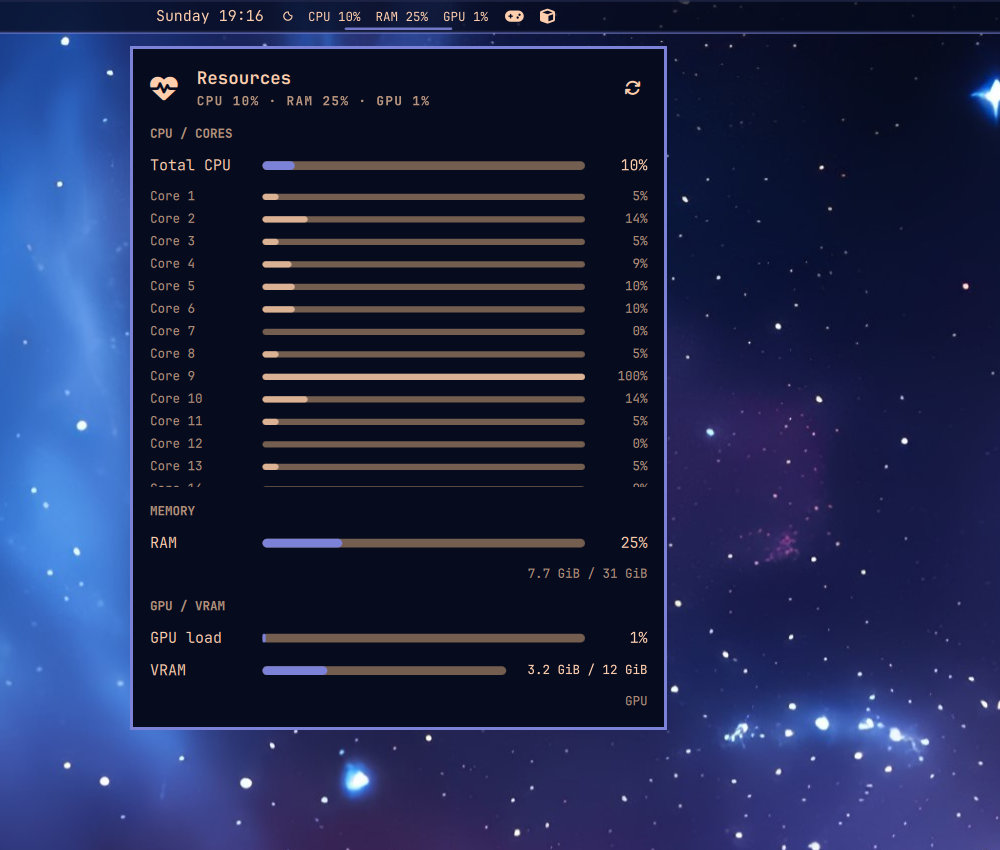

# xmanig.resources

A live Omarchy bar widget for CPU, per-core CPU, RAM, GPU, and VRAM usage.



## Install

Review the source, then install it with Omarchy:

```sh
omarchy plugin add https://github.com/xmanig/xmanig-omarchy-resources --enable
omarchy bar move xmanig.resources --section center
omarchy restart shell
```

The plugin lands at `~/.config/omarchy/plugins/xmanig.resources/`.

## Behavior

The center-bar label shows compact CPU, RAM, and GPU percentages. Click it to
open the detailed panel, which includes:

- Total CPU load
- A load bar for every CPU core
- RAM percentage plus used/total memory
- GPU engine load
- VRAM usage and used/total VRAM

Press `r` or use the refresh button to sample immediately. Middle- and
right-clicking the bar widget refreshes without opening the panel.

## Telemetry sources

- CPU and core load: `/proc/stat`, sampled over 200 ms
- RAM: `/proc/meminfo`, using `MemAvailable`
- NVIDIA GPU/VRAM: `nvidia-smi`, when available
- AMD GPU/VRAM: amdgpu sysfs counters under `/sys/class/drm`
- Intel GPU load: i915 `gt_busy_percent` when exposed by the kernel

No telemetry leaves the machine and no packages are installed by the plugin.

## Development

Validate locally with:

```sh
omarchy plugin validate .
bash -n scripts/collect-metrics
node --check Model.js
```

The plugin is user-owned and does not modify `/usr/share/omarchy`.
